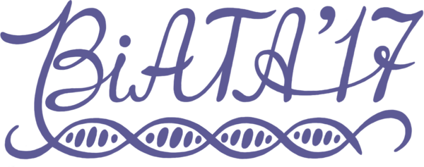{ .year-logo }

# BiATA 2017

1st international conference «Bioinformatics: from Algorithms to Applications»
{ .year-subtitle }

:material-calendar: August 1–3, 2017 &emsp; :material-map-marker: Saint Petersburg, Russia &emsp; :material-account-group: In person
{ .year-meta }

[:material-calendar-clock: Schedule](schedule.md){ .md-button }

!!! note "Book of abstracts"
    A book of abstracts for BiATA 2017 is not available in this archive.

## About

The first international conference «Bioinformatics: from Algorithms to Applications»
was held on August 1–3, 2017 at Saint Petersburg State University, Saint Petersburg, Russia.
It was followed by a two-day workshop on NGS data analysis (August 4–5) with practical
sessions in genomics, transcriptomics, metagenomics and immunogenomics.

**Topics:** Sequencing technologies · Molecular sequence analysis · Computational genomics ·
Genome assembly · Transcriptomics · Metagenomics · Immunogenomics

## Invited speakers

-   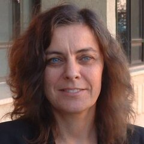{ .speaker-photo }
    **Jillian Banfield**

    Ph.D., UC Berkeley Professor (Earth & Planetary Science Dpt); Lawrence Berkeley National Laboratory Earth Sciences Division staff scientist

-   { .speaker-photo }
    **Nicholas Loman**

    Ph.D., Independent Research Fellow, Institute of Microbiology and Infection, University of Birmingham

-   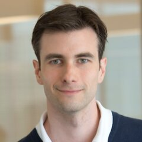{ .speaker-photo }
    **Jared Simpson**

    Ph.D., Principal Investigator, Ontario Institute for Cancer Research; Assistant Professor, Department of Computer Science, University of Toronto

-   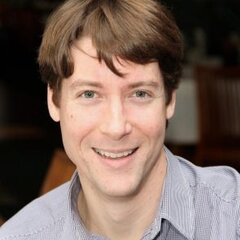{ .speaker-photo }
    **Adam Phillippy**

    Ph.D., Investigator, Head, Genome Informatics Section, Computational and Statistical Genomics Branch, National Human Genome Research Institute, NIH

-   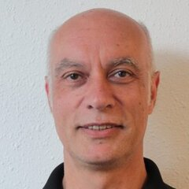{ .speaker-photo }
    **Dominique Lavenier**

    Ph.D., Research Director at the French National Center for Scientific Research

-   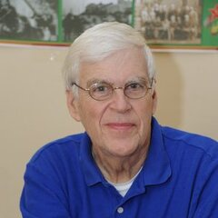{ .speaker-photo }
    **Stephen O'Brien**

    Ph.D., American geneticist. Chief Scientific Officer at the Theodosius Dobzhansky Center for Genome Bioinformatics, St. Petersburg State University

-   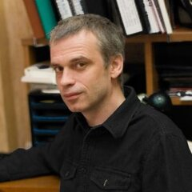{ .speaker-photo }
    **Sergey A. Lukyanov**

    RNRMU rector, academician of Russian Academy of Sciences, Laureate of the State Prize of the Russian Federation in the field of science and technology in 2015

-   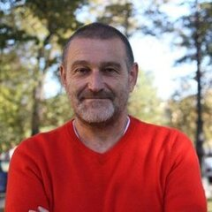{ .speaker-photo }
    **Pavel A. Pevzner**

    The UCSD professor, Head of the Center for Algorithmic Biotechnology, SPbU

-   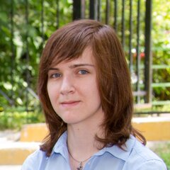{ .speaker-photo }
    **Ekaterina Khrameeva**

    PhD, Research Scientist, Skoltech Center for Data-Intensive Biomedicine and Biotechnology

## Photos

Photos from the first day of the conference, August 1, 2017.

<figure markdown>
[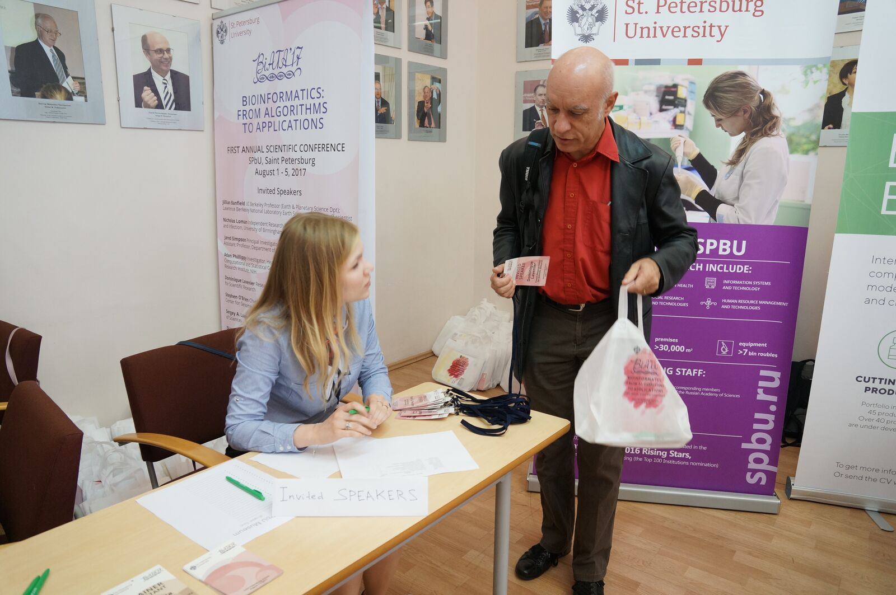](../assets/photos/2017/01-registration.jpg)
<figcaption>Registration</figcaption>
</figure>

<figure markdown>
[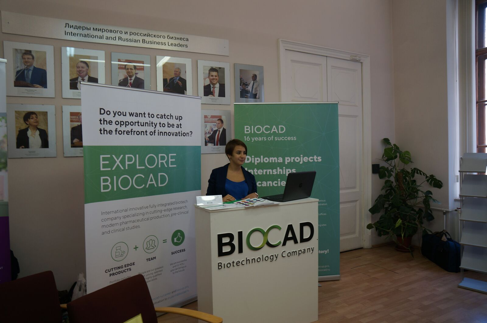](../assets/photos/2017/02-exhibition.jpg)
<figcaption>Sponsor exhibition</figcaption>
</figure>

<figure markdown>
[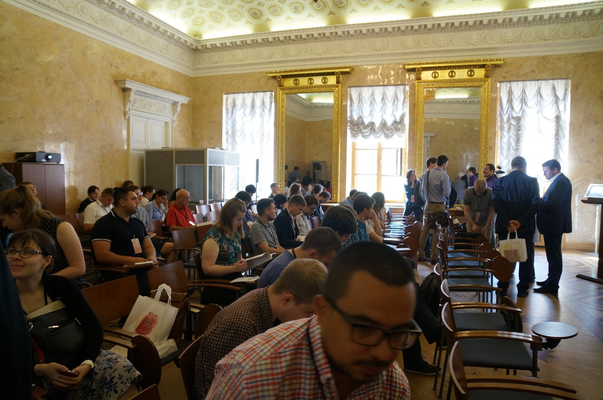](../assets/photos/2017/03-main-hall.jpg)
<figcaption>The main hall</figcaption>
</figure>

<figure markdown>
[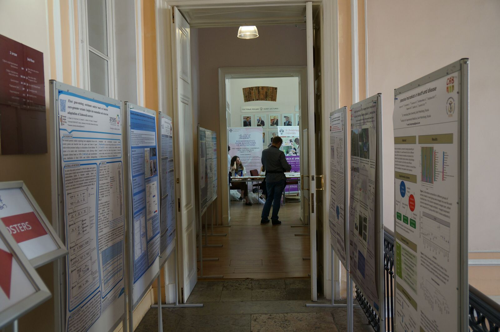](../assets/photos/2017/04-posters-corridor.jpg)
<figcaption>Posters in the corridor</figcaption>
</figure>

<figure markdown>
[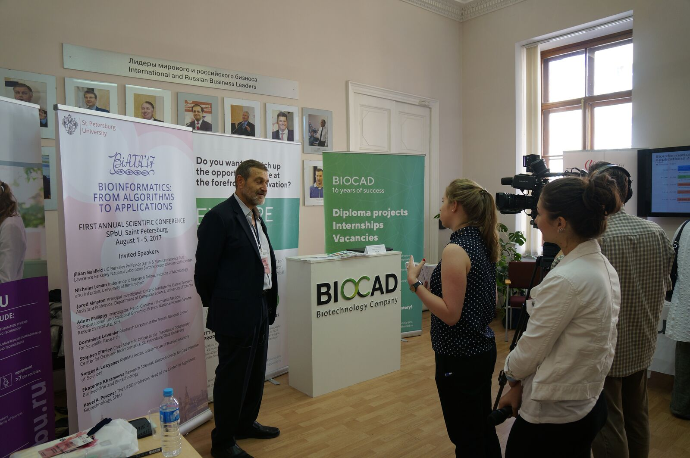](../assets/photos/2017/05-tv-interview.jpg)
<figcaption>A TV interview at the BIOCAD booth</figcaption>
</figure>

<figure markdown>
[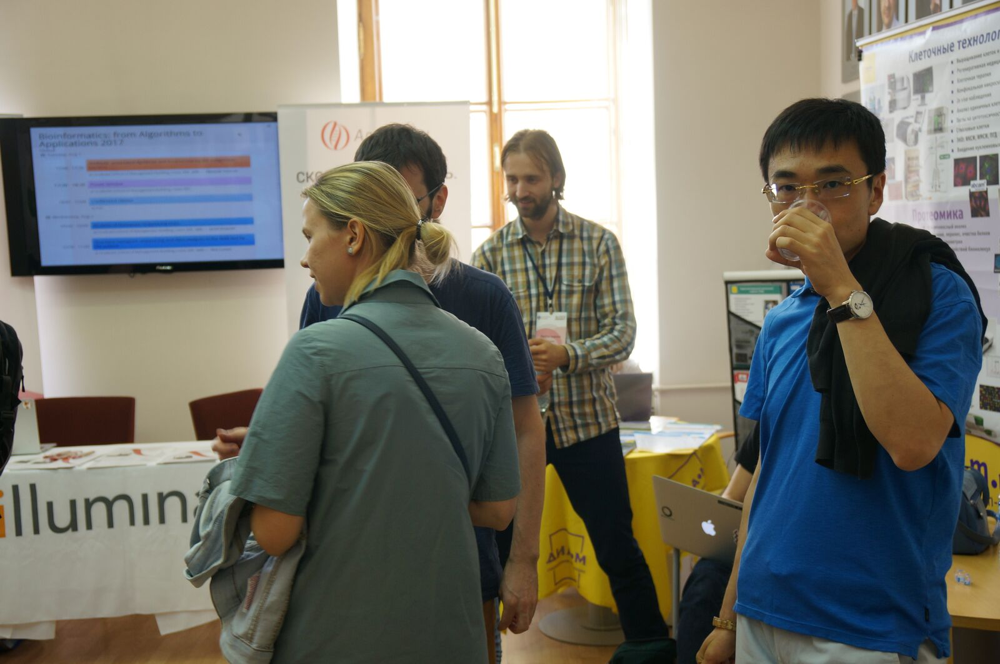](../assets/photos/2017/06-illumina-booth.jpg)
<figcaption>At the Illumina booth</figcaption>
</figure>

<figure markdown>
[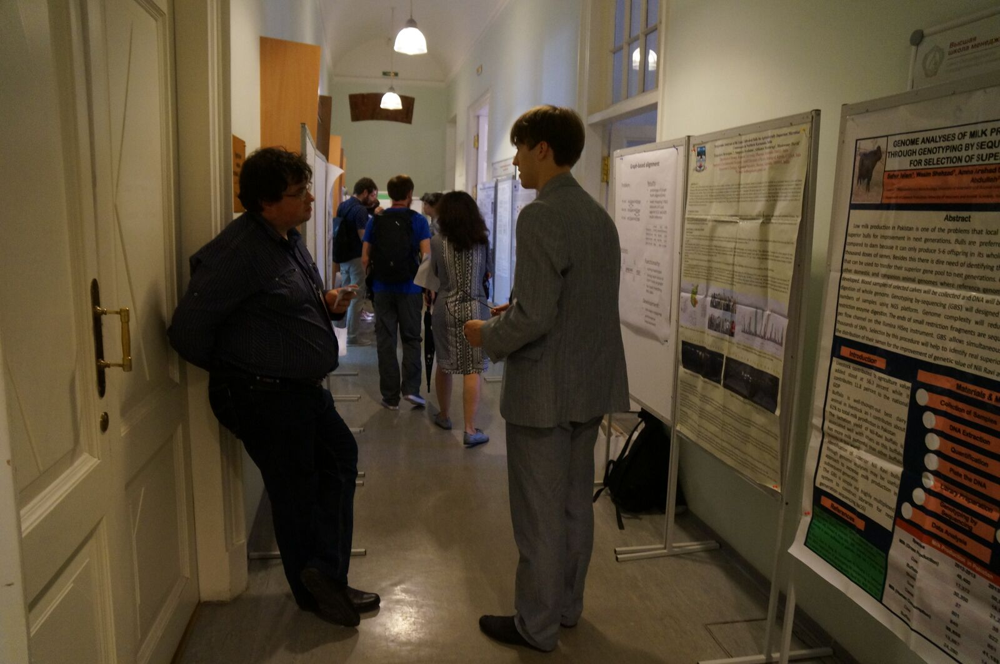](../assets/photos/2017/07-poster-session.jpg)
<figcaption>Poster session</figcaption>
</figure>

<figure markdown>
[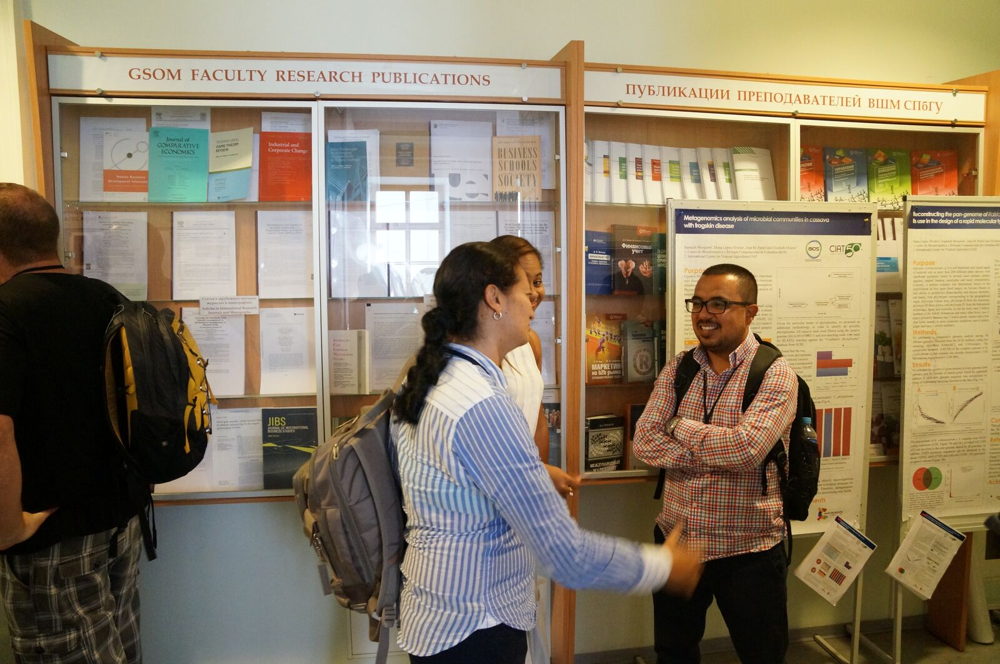](../assets/photos/2017/08-poster-discussion.jpg)
<figcaption>Poster session</figcaption>
</figure>

## Committees

### Program committee

| Name | Affiliation |
| --- | --- |
| Pavel A. Pevzner | The UCSD professor, Head of the Center for Algorithmic Biotechnology, SPbU |
| Max A. Alekseyev | Ph.D., Associate Professor, George Washington University (USA) |
| Mikhail S. Gelfand | D.Sc. (biol.), Ph.D. (math.), Prof. of Bioengineering and Bioinformatics at MSU, Head for Science at the Kharkevich Inst. for Information Transmission Problems RAS |
| Nikos Kyrpides | Ph.D., Prokaryote Super Program Head at Joint Genome Institute |
| Alla L. Lapidus | Ph.D., The SPbU professor, Deputy director of the Center for Algorithmic Biotechnology, SPbU |
| Sergey A. Lukyanov | RNRMU rector, academician of Russian Academy of Sciences, Laureate of the State Prize of the Russian Federation in the field of science and technology in 2015 |
| Anton I. Korobeynikov | Ph.D., Associate Professor, Department of Statistical modeling, Mathematics and Mechanics Faculty, SPbU |

### Organizing committee

| Name | Affiliation |
| --- | --- |
| Max A. Alekseyev | Ph.D., Associate Professor, George Washington University (USA) |
| Dmitry Antipov | Junior Researcher, Center for Algorithmic Biotechnology, SPbU |
| Sergey V. Bankevich | Programmer, Center for Algorithmic Biotechnology, SPbU |
| Andrey V. Bzikadze | Programmer, Center for Algorithmic Biotechnology, SPbU |
| Elena A. Bushmanova | Junior Researcher, Center for Algorithmic Biotechnology, SPbU |
| Anton I. Korobeynikov | Ph.D., Associate Professor, Department of Statistical modeling, Mathematics and Mechanics Faculty, SPbU |
| Alla L. Lapidus | Ph.D., The SPbU professor, Deputy director of the Center for Algorithmic Biotechnology, SPbU |
| Dmitri A. Meleshko | Junior Researcher, Center for Algorithmic Biotechnology, SPbU |
| Andrey Prjibelski | Junior Researcher, Center for Algorithmic Biotechnology, SPbU |
| Vlad Saveliev | Junior Researcher, Center for Algorithmic Biotechnology, SPbU |
| Alexander Y. Shlemov | Junior Researcher, Center for Algorithmic Biotechnology, SPbU |
| Elena Strelnikova | Manager, Center for Algorithmic Biotechnology, SPbU |
