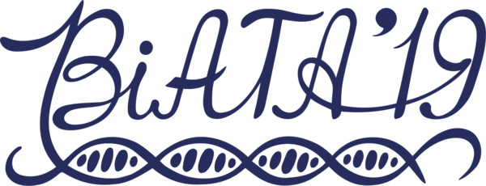

{ .year-logo }

# BiATA 2019

3rd international conference «Bioinformatics: from Algorithms to Applications»
{ .year-subtitle }

:material-calendar: June 20–22, 2019 &emsp; :material-map-marker: Saint Petersburg, Russia &emsp; :material-account-group: In person
{ .year-meta }

[:material-book-open-variant: Book of abstracts](../abstracts/BiATA-2019-abstracts.pdf){ .md-button .md-button--primary }
[:material-calendar-clock: Schedule](schedule.md){ .md-button }
[:material-youtube: Keynote videos](https://www.youtube.com/playlist?list=PL-_cKNuVAYAVgaKTguX1Gy8YNS8beGGy1){ .md-button }

## About

The third international conference «Bioinformatics: from Algorithms to Applications»
was held on June 20–22, 2019 in Saint Petersburg, Russia.

**Topics:** Sequencing technologies · Molecular sequence analysis · Computational genomics ·
Genome assembly · Transcriptomics · Metagenomics · Agrigenomics · Viromics · CRISPR ·
Natural products discovery

## Invited speakers

-   **C. Titus Brown**

    Associate Professor at the University of California, Davis

-   **Rob Finn**

    Team Leader, Sequence Families at European Bioinformatics Institute, European Molecular Biology Laboratory (EMBL-EBI)

-   **M. Pilar Francino**

    Head, Genomics and Health Area of FISABIO (Public Health Valencian Region Foundation for the Promotion of Health and Biomedical Research)

-   **Terry Gaasterland**

    Professor of Computational Biology and Genomics; Director, Scripps Genome Center

-   **Rob Knight**

    Professor at the University of California, San Diego, Co-founder of the Earth Microbiome Project

-   **Dmitry Morozov**

    CEO BIOCAD

-   **Marie-Agnès Petit**

    Leader of the Phage team in the Micalis Institute, INRA

-   **Mick Watson**

    Personal Chair of Bioinformatics and Computational Biology, Roslin Institute, University of Edinburgh

## Committees

### Program committee

| Name | Affiliation |
| --- | --- |
| Alla L. Lapidus | Ph.D., SPbU professor, Deputy director of the Center for Algorithmic Biotechnology, SPbU |
| Anton I. Korobeynikov | Ph.D., Associate Professor, Department of Statistical modeling, SPbU |
| Igor A. Tikhonovich | Head of Department of Biotechnology, Director of All-Russia Research Institute for Agricultural Microbiology (ARRIAM) |
| Sergey A. Lukyanov | RNRMU rector, Academician of the Russian Academy of Sciences, Laureate of the State Prize of the Russian Federation in the field of science and technology in 2015 |
| Andrey V. Lisitsa | D.Sc., Chief of the Institute of Biomedical Chemistry, Academician of the Russian Academy of Sciences |
| Mikhail S. Gelfand | D.Sc. and Ph.D., Member of Academia Europaea, Deputy Director of Institute for Information Transmission Problems |
| Oleg Gusev | Ph.D., Chief of OpenLabs, Institute of Fundamental Medicine and Biology, KFU |

### Organizing committee

| Name | Affiliation |
| --- | --- |
| Alla L. Lapidus | Ph.D., SPbU professor, Deputy director of the Center for Algorithmic Biotechnology, SPbU |
| Anton I. Korobeynikov | Ph.D., Associate Professor, Department of Statistical modeling, SPbU |
| Anton A. Nizhnikov | Ph.D., Head of Laboratory, All-Russia Research Institute for Agricultural Microbiology, Saint-Petersburg |
| Michael Rayko | Ph.D., Senior Researcher, Center for Algorithmic Biotechnology, SPbU |
| Elena Strelnikova | Manager, Center for Algorithmic Biotechnology, SPbU |
| Julia Kondratenko | Junior Researcher, Center for Algorithmic Biotechnology, SPbU |
| Tatiana Dvorkina |  |
