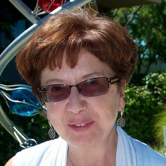
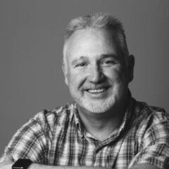
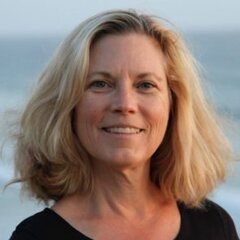
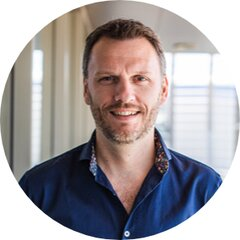
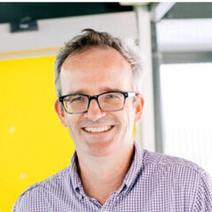
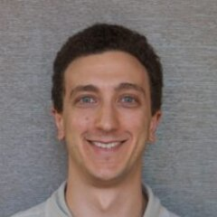
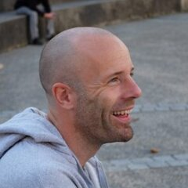
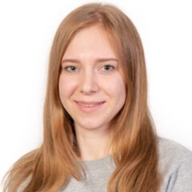

{ .year-logo }

# BiATA 2020

4th international conference «Bioinformatics: from Algorithms to Applications»
{ .year-subtitle }

:material-calendar: July 27–28, 2020 &emsp; :material-laptop: Online
{ .year-meta }

[:material-file-document-outline: Abstracts in BMC Bioinformatics](https://doi.org/10.1186/s12859-020-03838-2){ .md-button .md-button--primary }
[:material-calendar-clock: Schedule](schedule.md){ .md-button }

## About

The fourth international conference «Bioinformatics: from Algorithms to Applications»
was held online on July 27–28, 2020. Talks were pre-recorded and released to participants
in advance; the Q&A sessions, poster session and discussions took place by videoconference.
The conference was accompanied by a two-day online workshop on metagenomic data analysis
with MGnify.

**Topics:** Sequencing technologies · Molecular sequence analysis · Computational genomics ·
Genome assembly · Transcriptomics · Metagenomics · Agrigenomics · Viromics · CRISPR ·
Natural products discovery

## Invited speakers

-   { .speaker-photo }
    **Inna Dubchak**

    Affiliate, Lawrence Berkeley National Laboratory

-   { .speaker-photo }
    **Robert Fulton**

    Director of Technical Development, McDonnell Genome Institute

-   { .speaker-photo }
    **Terry Gaasterland**

    Professor of Computational Biology and Genomics; Director, Scripps Genome Center

-   { .speaker-photo }
    **Rob Finn**

    Team Leader, Sequence Families at European Bioinformatics Institute, European Molecular Biology Laboratory (EMBL-EBI)

-   { .speaker-photo }
    **Phil Hugenholtz**

    Professor of Microbiology; Director, Australian Centre for Ecogenomics, The University of Queensland, Australia

-   { .speaker-photo }
    **Stephen Nayfach**

    Research Scientist, DOE Joint Genome Institute

-   { .speaker-photo }
    **Pierre Peterlongo**

    Inria Rennes Bretagne Atlantique, GenScale team

-   { .speaker-photo }
    **Ekaterina Sakharova**

    EMBL-EBI

## Committees

### Program committee

| Name | Affiliation |
| --- | --- |
| Alla Lapidus | Ph.D., SPbU professor, Deputy director of the Center for Algorithmic Biotechnology, SPbU |
| Anton Korobeynikov | Ph.D., Associate Professor, Department of Statistical modeling, SPbU |
| C. Titus Brown | Associate Professor at the University of California, Davis |
| Rob Knight | Professor at the University of California, San Diego, Co-founder of the Earth Microbiome Project |
| Sergey A. Lukyanov | RNRMU rector, Academician of the Russian Academy of Sciences, Laureate of the State Prize of the Russian Federation in the field of science and technology in 2015 |
| Andrey V. Lisitsa | D.Sc., Chief of the Institute of Biomedical Chemistry, Academician of the Russian Academy of Sciences |
| Oleg Gusev | Ph.D., Chief of OpenLabs, Institute of Fundamental Medicine and Biology, KFU |
| Mikhail S. Gelfand | D.Sc. and Ph.D., Member of Academia Europaea, Deputy Director of Institute for Information Transmission Problems |

### Organizing committee

| Name | Affiliation |
| --- | --- |
| Alla Lapidus | Ph.D., SPbU professor, Deputy director of the Center for Algorithmic Biotechnology, SPbU |
| Anton Korobeynikov | Ph.D., Associate Professor, Department of Statistical modeling, SPbU |
| Elena Strelnikova | Manager, Center for Algorithmic Biotechnology, SPbU |
| Yulia Yakovleva | Saint Petersburg State University |
